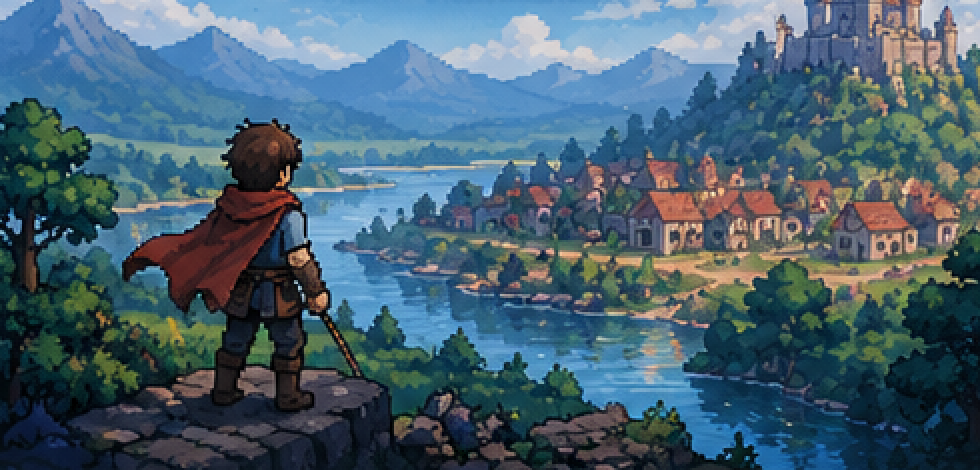
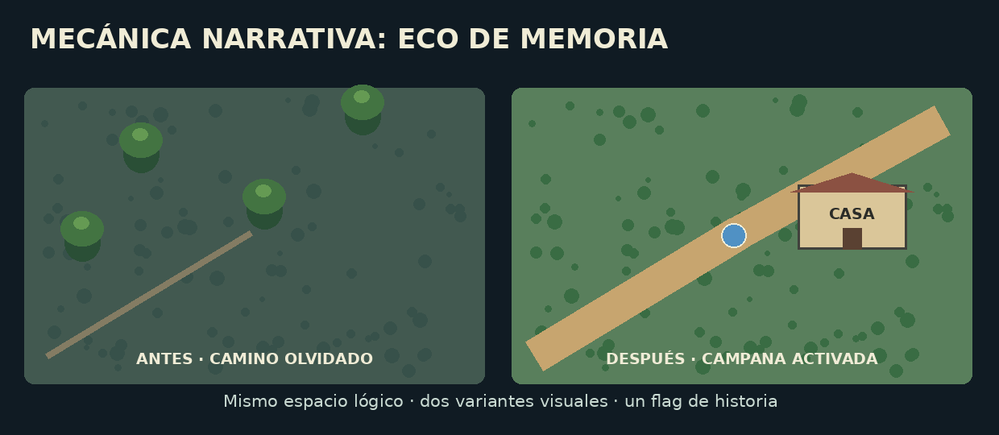
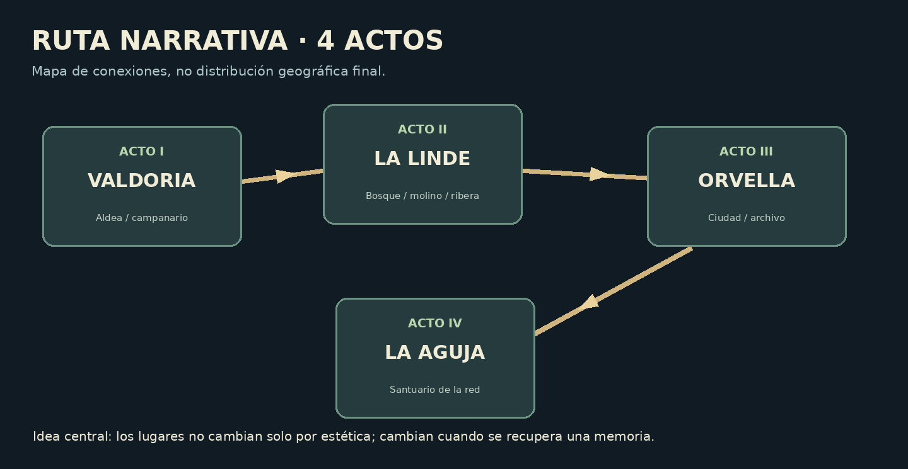
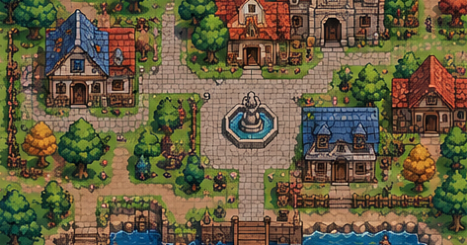
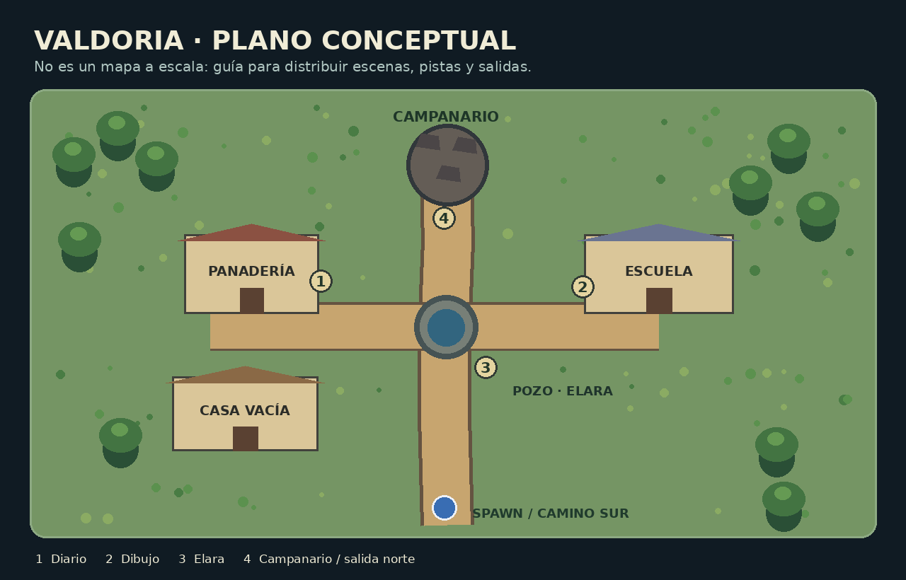
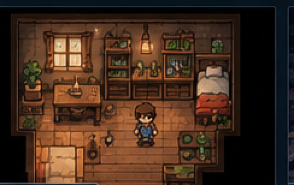
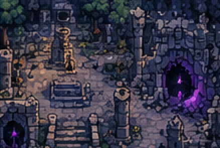
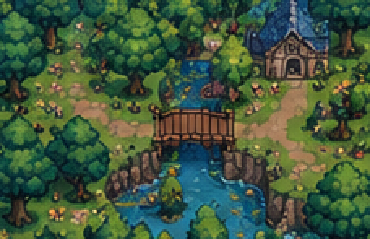
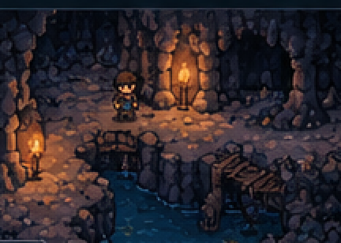

# EL ÚLTIMO HABITANTE

**Subtítulo provisional:** *El eco de Valdoria*  
**Documento:** Biblia narrativa y guía conceptual de niveles · v1.0 · 29 de octubre de 2026  
**Género:** RPG 2D de fantasía, exploración y misterio  
**Estado:** Propuesta de historia. Ningún elemento narrativo se considera implementado.

> **«Hay lugares que no desaparecen cuando los abandonamos. Desaparecen cuando dejamos de recordarlos».**

---

## 1. La idea en treinta segundos

Aren, un viajero que no sabe explicar por qué ha escogido determinado camino, llega al pueblo de **Valdoria** buscando refugio. Sus habitantes han desaparecido, pero quedan brasas encendidas y notas que hablan del día siguiente. En el centro del pueblo se encuentra un campanario derrumbado. No tiene campana. Aun así, cada atardecer se oyen tres campanadas.

A medida que recorre la región, Aren descubre que Valdoria no es el único lugar perdido. Hay aldeas que han desaparecido de los mapas, testigos que recuerdan historias contradictorias y una red de antiguos campanarios capaces de fijar los recuerdos colectivos a la realidad. Su búsqueda acaba siendo personal: **Valdoria es el pueblo del que escapó siendo niño, y alguien lleva décadas tratando de que regrese.**

**Pregunta central:** ¿es mejor preservar a quienes quedaron atrapados en el pasado o permitirles seguir adelante, incluso cuando eso significa perderlos?

### Lo que debe sentir el jugador

- **Curiosidad:** cada espacio plantea una anomalía pequeña y comprensible.
- **Inquietud sin terror gratuito:** no hay necesidad de monstruos ni de sustos repentinos. Lo extraño está en las contradicciones.
- **Melancolía:** el mundo es bello aunque esté roto; conviene que apetezca explorarlo.
- **Descubrimiento:** la historia no se limita a explicar la verdad; deja que el jugador la infiera de escenas, cambios de mapa y objetos.
- **Agencia:** el final depende de una decisión comprensible, no de una opción tramposa.

### Identidad visual

Fantasía medieval de pixel art: verdes cálidos en las zonas habitadas, madera y piedra, vegetación que recupera edificios, caminos rodeados de bosque y, progresivamente, tonos más fríos cerca de los lugares olvidados. **Las imágenes incluidas son referencias generadas para orientar la composición, no capturas del juego ni recursos listos para importarlos a Tiled.** El diseño final debe respetar el pack de sprites disponible.

---

## 2. El misterio y sus reglas

Para que no parezca que cualquier giro puede justificarse con «magia», el fenómeno necesita reglas internas relativamente estables. El jugador no las conoce todas al principio.

### Lo que el jugador descubre gradualmente

1. **Las campanas son anclas.** Antiguamente cada población tenía una campana ritual conectada a una red de santuarios. Su propósito era preservar la identidad de los lugares y los recuerdos de sus habitantes.
2. **Cuando un ancla se desconecta, el lugar puede quedar en un «eco».** Desde fuera cuesta encontrarlo y los registros ordinarios comienzan a contradecirse. Dentro, ciertos momentos se repiten o quedan suspendidos. No todos los lugares reaccionan igual.
3. **Los ecos conservan personas, pero no las hacen vivir normalmente.** Son presencias atrapadas en fragmentos de su último día. Pueden hablar, aprender pequeñas cosas y reconocer a alguien, pero no abandonar el límite del eco.
4. **Los recuerdos pueden recuperar caminos.** Un testimonio, un objeto o una campanada pueden hacer visible temporalmente algo que había sido olvidado. Eso se puede representar con dos variantes de un mismo mapa.
5. **La escritura ordinaria también puede alterarse.** Un diario encontrado dentro de un eco conserva su estado antiguo; fuera de él, los textos vinculados a la red pueden cambiar. Los registros protegidos del Archivo son la excepción.
6. **La red no concede viajes en el tiempo.** Recuperar una calle perdida no cambia cuarenta y siete años de historia. Recupera su presencia o la forma en que el mundo puede acceder a ella.

### Regla importante de guion

**No todo lo que nadie recuerda desaparece físicamente.** La red interviene solo en los lugares conectados a ella. Así se evita que la lógica del mundo dependa arbitrariamente de que un personaje piense o deje de pensar en una casa.

*Ejemplo de mecánica narrativa: al activar una campana, un camino inaccesible se hace visible. Es un cambio de estado del nivel, no un motor universal de deformación del mundo.*

---

## 3. Personajes

### Aren · protagonista

Un viajero observador y algo reservado, que llega a Valdoria pensando que solo busca alojamiento. Reconoce lugares que nunca recuerda haber visitado. Guarda un objeto sin saber de dónde viene: una pequeña pieza metálica con el símbolo de una campana partida.

**Secreto:** escapó de Valdoria siendo niño. Fuera del eco han pasado cuarenta y siete años. En los lugares afectados por la red, su apariencia se ajusta temporalmente a la imagen que Valdoria conserva de él. Por eso parece joven al llegar. Su edad real no tiene que convertirse en una mecánica de juego.

**Arco:** pasa de buscar una explicación para sí mismo a decidir qué responsabilidad tiene respecto a quienes quedaron atrás.

### Elara · guardiana del pozo

Anciana encargada antiguamente de escuchar la campana de Valdoria. Se presenta como una vecina que habla con frases extrañas, pero nunca miente directamente. En realidad, es un eco consciente de la última guardiana; ha esperado el regreso de Aren porque conoce la función de su pieza metálica.

**Arco:** necesita aceptar que preservar a alguien no siempre equivale a protegerlo.

**Frase:** «No preguntes dónde están. Pregunta cuándo estuvieron».

### Nilo · hermano de Aren

Niño de Valdoria que aparece en dibujos escolares, cuentos incompletos y marcas junto al campanario. Durante buena parte de la historia no se lo ve directamente.

**Secreto:** es el hermano menor de Aren. Fue quien comenzó a hacer sonar la campana desde el eco para llamar al único miembro de su familia que consiguió salir. No es el antagonista ni una aparición malvada.

**Arco:** quiere reencontrarse con Aren, pero también volver a vivir un mañana diferente.

### Iria · cartógrafa de caminos perdidos

Exploradora que mantiene mapas a mano porque los mapas oficiales se contradicen. Es la principal aliada de Aren fuera de Valdoria. Puede ayudar a interpretar señales y ofrecer contexto sobre aldeas perdidas.

**Función práctica:** NPC recurrente, punto natural para entregar pistas, misiones de exploración o mapas. No exige una IA compleja.

**Frase:** «Un mapa es una promesa: alguien debería poder llegar a ese lugar».

### Varo · custodio del Archivo

Responsable de mantener los anclajes de la región. Protege registros de lo que ocurrió hace cuarenta y siete años. Participó en la decisión de aislar varios pueblos durante una crisis de la red.

**Motivación:** evitar que el colapso de una campana arrastrara consigo una ciudad entera. Su decisión quizá salvó miles de vidas, pero condenó a Valdoria y a otras comunidades a quedar aisladas. No se considera a sí mismo un villano.

**Función narrativa:** oposición ideológica. Cree que hay pérdidas que deben aceptarse, pero también ocultó la verdad para proteger a su orden.

### Personajes menores opcionales

- **La panadera:** solo existe en un fragmento de memoria; su receta habla del festival que debía celebrarse al día siguiente.
- **El maestro:** dejó un registro incompleto de alumnos, con dos nombres repetidos de manera extraña.
- **El molinero:** un testigo fuera del eco que recuerda dos fechas diferentes para una misma tormenta.

No es necesario que todos sean NPCs animados. Muchos pueden existir a través de objetos, notas o una única conversación.

---

## 4. Estructura general del mundo

El juego no tiene por qué limitarse a un único mapa ni a una duración de quince minutos. **La historia está diseñada para añadir zonas y escenas cuando el motor lo permita.** Se puede entregar una porción autocontenida sin cerrar la trama general.

| Acto | Región | Pregunta narrativa | Función jugable |
|---|---|---|---|
| I | Valdoria | ¿Dónde están los habitantes? | Introducción, pistas e interacción |
| II | Los caminos de la Linde | ¿Por qué desaparecen otros lugares? | Exploración, mapas interconectados y cambios de estado |
| III | Orvella y el Archivo | ¿Quién aisló los pueblos y por qué? | Investigación, consecuencias y conflicto humano |
| IV | Santuario de la Última Campana | ¿Qué hacer con los ecos? | Revelación y decisión final |

Las duraciones dependen de cuánto contenido se añada. Como orientación narrativa, una versión completa podría dedicar 25–40 minutos al primer acto y desarrollar los siguientes con varios mapas, interiores y actividades secundarias. **No es una estimación de implementación ni una obligación para la entrega.**

---

## 5. ACTO I · La aldea silenciosa

### Zona A. El camino del sur

El jugador aparece en un sendero que atraviesa un pequeño bosque. Dos carteles, separados por varios minutos de caminata, indican exactamente lo mismo: «Valdoria, 2 km». El segundo parece mucho más viejo.

**Objetivo visible:** llegar al pueblo antes de que anochezca.

**Primera anomalía:** un sendero a un lado del camino parece continuar entre los árboles, pero no conduce a ninguna parte; de momento no hace falta hacerlo transitable.

**Escena de entrada:** al cruzar el límite de Valdoria, suenan tres campanadas. Aren ve las ruinas del campanario y descubre que no hay campana.

### Zona B. La plaza de Valdoria

El centro jugable del primer acto. Debe ser un espacio reconocible: pozo, campanario al norte, dos casas distinguibles, acceso desde el sur y caminos hacia futuras zonas.

*El plano representa relaciones espaciales y flujo de exploración, no el tamaño definitivo en tiles. Se puede dividir en varios `.tmx` si el diseño lo requiere.*

**Tres pistas principales, explorables en cualquier orden:**

1. **Casa de la panadera.** Una mesa preparada para la celebración del día siguiente. El diario dice: «Mañana vendrán las familias de la Linde». La fecha es de hace cuarenta y siete años.
2. **Escuela.** Un dibujo muestra el campanario intacto y dos niños junto a él. Uno se llama Nilo. El otro tiene la cara borrada. En el registro de clase aparece un hueco entre dos nombres.
3. **Pozo.** Al examinarlo después de encontrar una pista, aparece Elara. Su conversación sugiere que el pueblo no fue abandonado: se quedó esperando.

**Barreras suaves:** la puerta o escalera de las ruinas no se abre hasta que el jugador haya investigado las pistas principales. Es una condición de estado, no una llave obligatoria de inventario.

### Zona C. Las ruinas del campanario

Tras reunir las pistas, Aren encuentra bajo las piedras un mecanismo con el símbolo de su pieza metálica. Al acercarla, escucha un recuerdo: dos niños discutiendo sobre quién tocará la campana durante la fiesta.

Elara revela que los nombres eran **Aren y Nilo**, pero evita explicarle aún el destino del pueblo. Muestra un mapa antiguo donde aparecen otros asentamientos tachados.

**Final del acto:** una campanada hace visible un camino al norte que antes parecía terminar en el bosque. El mapa cambia. Aren decide seguirlo.

**Última frase del capítulo:** «Lo que ocurrió aquí no terminó en Valdoria».

### Lo que deja preparado este acto

- Un misterio personal y otro regional.
- Un personaje que podrá volver a aparecer.
- Un lenguaje visual para las pistas y recuerdos.
- Una demostración útil de interacciones, flags y transiciones de mapa.
- Un **final de demo** satisfactorio, sin fingir que es el final definitivo del juego.

---

## 6. ACTO II · Los caminos olvidados

### Zona A. Bosque de la Linde

Un bosque atravesado por dos caminos que supuestamente llegan al mismo puente. Uno de ellos solo aparece cuando Aren conserva un recuerdo concreto. Iria, una cartógrafa, observa que sus propios mapas cambian entre visitas.

**Mecánica narrativa:** regresar a una zona después de un evento importante y descubrir que hay un camino más. Se puede implementar con mapas alternativos, capas activadas por flags o ambas cosas.

### Zona B. Molino del río

Un molino abandonado y una vivienda aún habitada. El molinero recuerda una tormenta ocurrida «hace veinte años»; los registros del puente aseguran que ocurrió hace cuarenta y siete. No es que el personaje mienta: parte de su memoria ha sido editada.

**Pista:** la campana de Valdoria era una entre muchas. El mapa de Iria muestra conexiones entre aldeas, como si el reino estuviera unido por una red subterránea de ecos.

### Zona C. Fresna, el pueblo que sigue existiendo

Una pequeña comunidad normal, pero sus habitantes discrepan sobre la existencia de su vecina, la aldea de Liria. Algunos la recuerdan; otros ven únicamente bosque donde debería estar.

**Momento importante:** el jugador puede presentar una prueba a un vecino. No necesita un sistema de diálogo ramificado: una opción activa un flag, cambia dos frases y altera un detalle del entorno en la siguiente visita.

### Revelación del acto

La desaparición de Valdoria **no fue un accidente aislado**. Una antigua organización desconectó deliberadamente campanas de distintos pueblos durante una catástrofe. La información conservada en Orvella, ciudad del Archivo, podría explicar qué sucedió.

**Cliffhanger:** el mapa de Iria contiene una ruta hasta Orvella y un símbolo idéntico al que lleva Aren.

---

## 7. ACTO III · El archivo de los nombres

### Zona A. Orvella

La primera gran ciudad del juego. No tiene por qué ser enorme: bastan una plaza central, una calle de viviendas, el acceso a una biblioteca y algunos interiores. Debe contrastar con Valdoria: gente, comercio, actividad y ausencia aparente de fenómenos extraños.

Aren descubre, sin embargo, que hay nombres de poblaciones arrancados de viejos documentos. La ciudad parece haber decidido dejar de hablar de ellas.

### Zona B. Archivo de los Nombres

El Archivo conserva documentos protegidos contra la alteración de la red. Iria ayuda a comparar cartas con los mapas del pasado.

Los registros describen una crisis ocurrida hace cuarenta y siete años: una cadena de campanadas empezó a propagar ecos entre pueblos. Los custodios optaron por aislar varias campanas para detenerla.

**Gran giro:** Aren no llegó a Valdoria por casualidad. Cuando era niño, Elara lo sacó del eco a través de un pasaje de emergencia. La ruptura borró sus recuerdos del pueblo. El fragmento metálico que siempre ha llevado es la llave de ese pasaje.

### Zona C. Sala de Varo

Varo admite que ordenó el aislamiento. Defiende su decisión: si no hubiera separado la red, Orvella podría haber caído en el mismo fenómeno.

No es una escena de «villano revela el plan». Es una discusión moral. Varo ocultó pruebas de las comunidades sacrificadas para evitar que alguien reconectara la red sin entender sus riesgos.

**Segundo giro:** las campanadas que Aren oye no son una alarma antigua: **Nilo ha aprendido a producirlas desde el interior del eco**, tratando de recuperar a su hermano.

### Final del acto

La única forma de intervenir en la red es llegar a su ancla central, **la Última Campana**, situada bajo un santuario antiguo. Varo no puede detener a Aren sin destruir también los registros que ha jurado custodiar. Decide entregarle el último mapa, pero le pide que comprenda el precio antes de actuar.

---

## 8. ACTO IV · La última campana

### Zona A. El sendero de piedra

El trayecto final mezcla lugares reconocibles con pequeños ecos de escenas anteriores. Una casa que se parecía a la panadería, un cartel repetido, una voz junto al río. No requieren niveles gigantes: son referencias que conectan el recorrido con la historia.

### Zona B. El santuario

El interior alberga las conexiones de la red. Inscripciones antiguas aclaran el mecanismo: la campana puede **mantener los ecos aislados**, **reconectarlos al presente** o **dejarlos desvanecerse**. Nadie puede retroceder el tiempo ni resucitar sin consecuencias a una población entera.

### Zona C. El encuentro con Nilo

Por primera vez aparece Nilo. Reconoce a Aren al instante. Aren recuerda la celebración, la catástrofe y el momento en que Elara lo sacó del pueblo.

Nilo no suplica que el protagonista tome una decisión determinada. Quiere que elija sabiendo quiénes son las personas atrapadas.

### La decisión final

El mecanismo ofrece dos acciones narrativas completas:

**FINAL A · RESTITUIR («Un mañana»)**

Aren reconecta la red y permite que los ecos estables vuelvan al presente. Valdoria reaparece en los caminos de la región y sus habitantes pueden volver a vivir el paso del tiempo. La restauración exige una memoria fuerte como ancla: Aren entrega parte de los recuerdos que construyó fuera de Valdoria. Conserva la certeza de haber elegido, pero ya no recuerda todos los años de su ausencia.

**Imagen final:** el pueblo despierta; Nilo ve amanecer sin que el día se repita. Aren observa una carta escrita por él mismo, incapaz de reconocer la letra.

**Última frase:** «Esta vez, mañana será un día distinto».

**FINAL B · DEJAR IR («Recordarlos»)**

Aren apaga la red de ecos para que nunca vuelva a atrapar a nadie. Valdoria y las otras comunidades aisladas dejan de sostenerse como fragmentos suspendidos. Sus habitantes se despiden; sus historias permanecen en los registros del Archivo y en la memoria de quienes las conocieron.

**Imagen final:** Aren e Iria colocan el nombre de Valdoria en un mapa nuevo. Allí donde antes se veía el pueblo quedan ruinas cubiertas de hierba, pero el camino ya no desaparece.

**Última frase:** «Que un lugar termine no significa que no haya existido».

> **Regla de diseño:** ninguno de los finales debe presentarse como el «correcto». Uno prioriza dar un futuro a los atrapados a un coste personal; el otro rompe definitivamente el mecanismo que permitió la catástrofe y preserva la verdad de lo perdido.

---

## 9. Escenas de diálogo listas para adaptar

Diálogos originales de ejemplo. Se pueden mostrar como cajas de texto simples con avance por tecla; no requieren doblaje ni un sistema de conversación complejo.

### Escena 1 · Entrada a Valdoria

**Aren:** «El cartel decía que faltaban dos kilómetros. El anterior también».  
**Aren:** «Parece que aquí no vive nadie».  
*[Suenan tres campanadas.]*  
**Aren:** «¿De dónde ha venido eso?»  
*[El campanario está en ruinas. No hay campana.]*

### Escena 2 · Elara, junto al pozo

**Aren:** «¿Dónde está la gente del pueblo?»  
**Elara:** «Haces la pregunta equivocada».  
**Aren:** «Entonces dime cuál es la correcta».  
**Elara:** «No preguntes dónde están. Pregunta cuándo estuvieron».  
**Aren:** «¿Nos conocemos?»  
**Elara:** «Te conocí antes de que aprendieras a olvidar».

### Escena 3 · El dibujo de la escuela

**Aren:** «Nilo… Ese nombre…».  
*[En el papel aparecen dos niños frente a una campana.]*  
**Aren:** «¿Por qué han borrado al otro?»  
*[Al tocar el dibujo, se oye una voz infantil.]*  
**Voz:** «Aren, te toca a ti».

### Escena 4 · El encuentro final

**Nilo:** «Pensé que no recordarías el camino».  
**Aren:** «No lo recordaba. Pero llevaba años buscándolo».  
**Nilo:** «¿Y ahora?»  
**Aren:** «Ahora sé que no puedo elegir por ti».  
**Nilo:** «No. Pero puedes escucharme antes de hacerlo».

---

## 10. Ideas de mapas para Tiled

Este apartado se puede entregar directamente a un agente encargado de diseñar niveles. **No establece formatos definitivos ni presupone que el loader actual ya implemente estas funciones.**

### Conjunto mínimo de mapas

| Identificador provisional | Propósito | Elementos visibles | Datos de gameplay |
|---|---|---|---|
| `camino_sur` | Introducción | Bosque, dos carteles, llegada | Spawn y salida norte |
| `valdoria_plaza` | Núcleo del primer acto | Pozo, casas, campanario, caminos | Pistas, Elara, entrada bloqueada |
| `casa_panadera` | Primera pista | Mesa, horno, diario | Interacción con diario |
| `escuela` | Segunda pista | Pizarra, mesas, dibujo | Interacción con dibujo |
| `campanario_ruinas` | Cierre del primer acto | Ruinas, mecanismo central | Comprobación de pistas, evento |
| `bosque_linde` | Acto II | Senderos, puente, vegetación | Variantes del camino |
| `molino_rio` | Acto II | Molino, agua, vivienda | Testigo y segunda pista |
| `fresna` | Acto II | Pueblo habitado | NPCs y cambio de testimonio |
| `orvella` | Acto III | Plaza y edificios | Acceso al Archivo |
| `archivo` | Acto III | Estanterías y registros | Escenas con Iria y Varo |
| `santuario` | Acto IV | Ruinas y campana central | Diálogo final y elección |

No hace falta implementar todos los interiores como mapas separados si el tiempo no acompaña. Una interacción desde la puerta puede abrir una escena narrativa. La estructura existe para **poder** escalar, no para obligar a escalar desde el primer día.

### Capas recomendadas

- `Ground`: suelo base.
- `Paths`: caminos y transiciones que se dibujan encima del suelo.
- `Decor`: vegetación, muebles y detalles no interactivos.
- `AbovePlayer`: techos, copas o estructuras que deben dibujarse sobre el personaje cuando corresponda.
- `Collision`: datos de bloqueo; no es obligatorio renderizarlos.
- `Entities`: capa de objetos de Tiled: puntos de spawn, NPCs, puertas, pistas y triggers.
- `Triggers` (opcional): zonas rectangulares para entradas, campanadas o cambios de escena.

La clasificación exacta depende de cómo evolucione el renderer. **Los objetos interactivos son entidades; los tiles estáticos son mapa**, tal y como se ha definido para el proyecto.

### Ejemplo de propiedades para objetos de Tiled (propuesta, no API existente)

| Objeto | Propiedades conceptuales | Efecto |
|---|---|---|
| `player_spawn` | `type=spawn`, `id=entrada_sur` | Sitúa al jugador |
| `diario_panadera` | `type=interact`, `story_event=read_diary` | Activa flag de historia |
| `elara` | `type=npc`, `dialogue=elara_pozo` | Muestra diálogo |
| `puerta_campanario` | `type=exit`, `requires=clues_complete`, `dest=campanario_ruinas` | Transición diferida |
| `campana` | `type=interact`, `story_event=ring_bell` | Activa escena y variante |

**No hace falta desarrollar un framework genérico de eventos para la primera versión.** Un identificador, un `switch` fácil de depurar y unos flags persistentes pueden bastar. Las propiedades son un contrato deseable para el futuro conversor, no una petición de reescribir el loader actual.

### Un mapa con dos estados

El «bosque antes/después» puede resolverse de cualquiera de estas maneras:

1. Dos mapas diferentes unidos por una transición (`bosque_a` y `bosque_b`). **La más sencilla si el loader aún es básico**.
2. Dos conjuntos de capas activados según un flag.
3. Un solo mapa con algunos tiles reemplazados durante un evento.

Para el desarrollo de la demo, la primera opción tiene menos requisitos y permite validar la historia sin construir un sistema universal.

---

## 11. Encaje con el RPG en C

**Diseño de alto nivel, no instrucciones para modificar automáticamente el código.**

### Sistemas ya existentes o iniciados en el proyecto

Movimiento y cámara, entidades y AABB, gestión de texturas, estados del juego, renderizado de mapas y carga inicial de CSV. Estas piezas sostienen la exploración.

### Sistemas necesarios para una primera experiencia narrativa

1. Colisión del jugador contra tiles sólidos.
2. Interacción básica por proximidad y tecla.
3. Caja de texto que muestre líneas y permita avanzar.
4. Flags de historia (leído diario, encontrado dibujo, hablado con Elara).
5. Transición de nivel solicitada desde la lógica y ejecutada en un punto seguro.
6. Un evento de campana y una pantalla de cierre de capítulo.

### Sistemas opcionales, a ampliar después

- Animaciones por orientación y estado, sin acoplar la simulación a los FPS de renderizado.
- Música ambiental y SFX sencillos llamados directamente desde la interacción.
- Sistema de misiones con registro de pistas.
- Combate por turnos, si finalmente forma parte de la identidad del RPG. **No es necesario para contar el primer acto.** Podría aparecer como una capa mecánica separada de la exploración; no hay que diseñarlo antes de comprobar el bucle narrativo básico.
- Guardado y carga persistente del progreso.
- Variantes de mapas y mayor número de NPCs.
- Empaquetado de mapas y texturas en el ejecutable al pasar a producción.

**Principio:** no construir un gran sistema porque la historia lo sugiera. Construir una interacción completa, comprobarla y reutilizarla en otras escenas.

---

## 12. Tres tamaños posibles del mismo proyecto

### A. Entrega funcional mínima

**Objetivo:** demostrar motor + comienzo de la historia.

- Un mapa de aldea (con accesos simulados a otras zonas, si hace falta).
- Movimiento, colisiones, cámara y un personaje visible.
- Tres objetos interactivos: diario, dibujo y pozo.
- Un diálogo de Elara y tres campanadas.
- Puerta del campanario con condición de desbloqueo.
- Texto final: «Lo que ocurrió aquí no terminó en Valdoria».

Esto no pretende ser un RPG completo, sino una **demo de apertura claramente identificada**.

### B. Primer capítulo jugable

**Objetivo:** una experiencia pequeña pero con comienzo, desarrollo y cierre de capítulo.

- Camino introductorio + plaza + interiores + ruinas.
- Animaciones básicas, música y efectos.
- Interacciones contextuales, NPC, diario/dibujo y transición a mapa nuevo.
- Revelación inicial de Aren y Nilo.
- Camino norte que aparece y conduce al siguiente capítulo.

### C. Juego completo (visión a largo plazo)

**Objetivo:** cuatro actos, varias comunidades, investigación de la red, relación con Iria y Varo, desenlace con dos decisiones.

El número de mapas, las mecánicas de RPG y la duración se determinarán durante el desarrollo. La estructura de actos permite añadir contenido sin cambiar la premisa del primer capítulo.

---

## 13. Guía artística para Claude, Codex u otro diseñador de mapas

> **Encargo:** Diseña el pueblo abandonado de Valdoria para un RPG 2D top-down en pixel art. Debe parecer un sitio que estuvo habitado ayer y lleva décadas esperando. Crea una plaza legible con un pozo central, una panadería distinguible, una escuela, casas menores, un campanario en ruinas y una salida hacia el sur. El recorrido principal debe poder encontrarse sin un minimapa. Incluye lugares de interés y zonas de descanso visual; evita repetir el mismo patrón de terreno de manera demasiado evidente. Conserva la identidad de los tilesets proporcionados.
>
> **Flujo de trabajo:** Inspecciona primero los PNG originales y sus dimensiones reales. Identifica qué tiles sirven de base, cuáles son transiciones y qué objetos necesitan varias celdas. Construye un pequeño prototipo, expórtalo, comprueba su aspecto mediante un render real y itera. No inventes GIDs ni asumas que todos los atlas tienen el mismo espaciado. Genera los archivos de Tiled en una carpeta nueva, sin sobrescribir los existentes. Documenta qué capas son visuales, cuáles contienen colisiones y dónde están los spawns e interacciones.
>
> **Restricciones:** no modificar el motor en C para «hacer encajar» un mal mapa; no ampliar el alcance con nuevos subsistemas gráficos; no dejar objetos que bloqueen por accidente la ruta principal. Usar los conceptos gráficos incluidos como inspiración, **no intentar reproducirlos literalmente** con tiles que no existan en el pack.

### Checklist para revisar cada mapa generado

- [ ] Se distingue el suelo de los caminos.
- [ ] Las transiciones del terreno no muestran costuras extrañas.
- [ ] Hay una jerarquía visual clara (puntos importantes y decoración secundaria).
- [ ] Se puede identificar dónde empieza y termina la ruta principal.
- [ ] Los edificios tienen espacio alrededor y no bloquean accesos.
- [ ] El player puede aproximarse a cada objeto interactivo.
- [ ] El orden de capas permite que árboles y tejados cubran al personaje cuando corresponda.
- [ ] Los datos de colisión y entidades tienen sentido aunque se oculte la capa visual.
- [ ] Un render real del mapa coincide con lo que parecía correcto en el editor.

---

## 14. Sonido y atmósfera

No hace falta una simulación acústica. Se busca identidad, no complejidad técnica.

- **Valdoria:** viento suave, crujido de madera, silencio entre detalles y tres campanadas reconocibles.
- **Bosque:** pájaros ocasionales, hojas, agua cerca de los puentes.
- **Orvella:** ambiente de ciudad y una música más regular, para que la normalidad resulte casi sospechosa.
- **Santuario:** pocas notas sostenidas; la campana aparece como motivo principal.

Un mismo motivo corto de campanas puede variar de timbre o armonía entre actos. Es una oportunidad de música narrativa si apetece componer, **no un requisito para comenzar a implementar la historia**.

---

## 15. Resumen de los giros (solo para quien escriba el juego)

**SPOILERS COMPLETOS**

1. Valdoria no fue evacuada: fue aislada dentro de un eco hace cuarenta y siete años.
2. Elara salvó a Aren cuando era niño; el mecanismo borró sus recuerdos de Valdoria.
3. El segundo niño del dibujo es Aren, y Nilo es su hermano.
4. Las campanas no suenan solas: Nilo aprendió a llamar a su hermano desde el eco.
5. Valdoria no es única; Varo desconectó varios asentamientos para impedir que colapsara la red entera.
6. Varo ocultó el coste humano de la decisión, pero su miedo a una catástrofe mayor tenía fundamento.
7. Aren tiene acceso a la ancla central y debe decidir entre restituir a los atrapados, sacrificando parte de su propia memoria, o desactivar los ecos para siempre y conservar su historia.

### La idea que une todo

La historia no trata solo sobre «lugares olvidados». Trata sobre **la diferencia entre mantener algo intacto y permitir que siga vivo**. Valdoria se conserva casi perfectamente porque nunca ha podido avanzar. El jugador debe decidir si ese tipo de preservación merece el precio.

---

## 16. Archivo visual adjunto

Los PNG de `imagenes/` se incluyen con el documento para funcionar **sin conexión**:

| Archivo | Uso sugerido |
|---|---|
| `camino_a_valdoria.png` | Portada / atmósfera del viaje |
| `aldea_valdoria.png` | Inspiración para el poblado |
| `plano_valdoria.png` | Diagrama de disposición de pistas y lugares |
| `bosque_de_la_linde.png` | Inspiración para rutas forestales |
| `ruinas_del_campanario.png` | Inspiración para ruinas |
| `interior_de_la_casa.png` | Referencia de interiores |
| `santuario_subterraneo.png` | Referencia del último acto |
| `ruta_de_los_actos.png` | Estructura del mundo y progresión |
| `variantes_recuerdo.png` | Mecánica visual antes/después |

**Nota sobre autoría y uso:** estas ilustraciones son **concept art original generado para este documento** y diagramas esquemáticos, no recursos del juego, capturas de Tiled ni diseños de niveles validados. Las imágenes de referencia pueden contener detalles que no existan en los sprites disponibles. La historia, los personajes y los diálogos de este documento son propuestas originales que pueden modificarse libremente durante el desarrollo.
